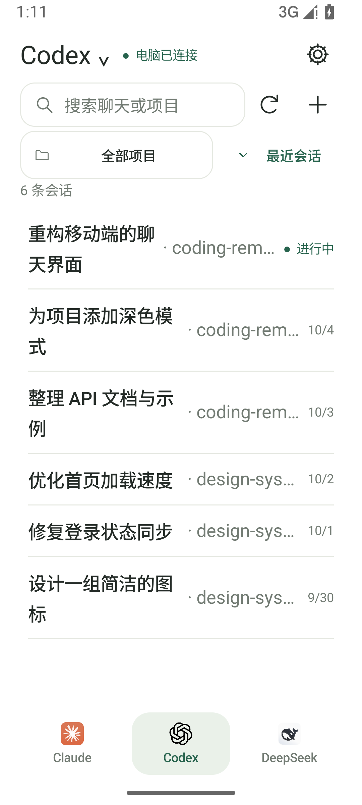
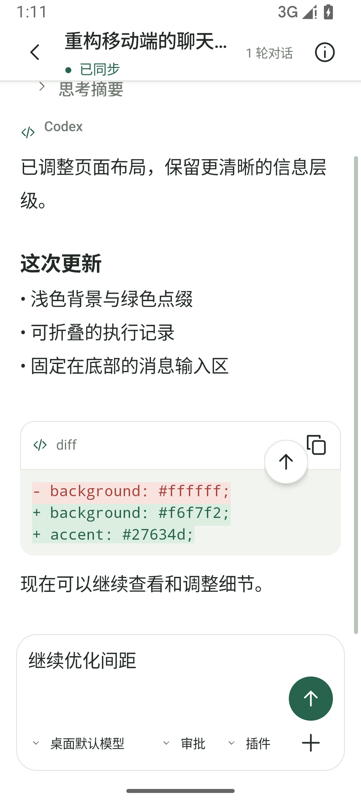
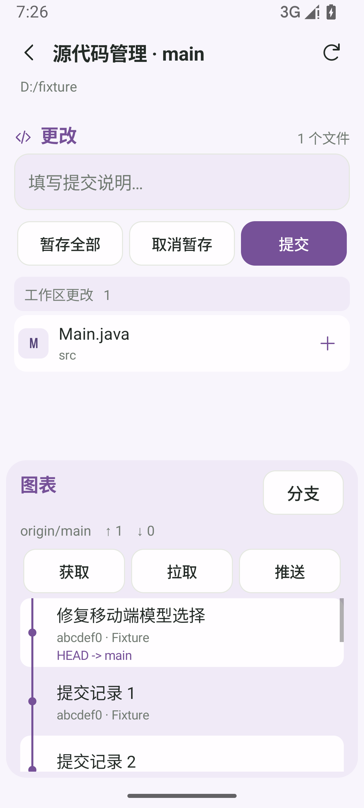

# coding远程

**电脑执行任务，手机继续对话。**

coding远程是一款连接 Windows 桌面 AI 编程客户端与 Android 手机的社区工具。你可以在手机上继续 Claude desktop、Codex 和 DeepSeek Harness 的会话，查看执行进度、回答提问、处理审批，以及检查项目文件和 Git 更改。

本项目在 [Abyxs/codex-mobile-assistant](https://github.com/Abyxs/codex-mobile-assistant) 的基础上进一步扩展，包含 Windows 助手、Android 原生界面和本地适配代码。Abyxs 的项目是 [try2love/codex-mobile-bridge](https://github.com/try2love/codex-mobile-bridge) 的二次开发版本，**本项目使用的原始 Windows EXE 和 Android APK 均来自 Abyxs/codex-mobile-assistant**。

任务仍由电脑上的客户端执行，需要电脑、助手和对应客户端保持运行。

[快速开始](docs/quick-start.md) · [手机功能](docs/android-ui.md) · [常见问题](docs/faq.md) · [构建说明](docs/native-build.md) · [版本记录](docs/releases.md)

## 功能特性

| 功能 | 使用方式 |
| --- | --- |
| 三种客户端 | 在 Claude、Codex、DeepSeek 页面之间切换，按项目查看、搜索、新建和管理会话；Claude 支持 Code / Work（Cowork）。 |
| 会话控制 | 发送消息、停止任务、回答桌面提问、处理审批；模型、思考强度和插件选项随桌面能力提供。 |
| 消息队列 | 执行中继续输入会加入队列，任务结束后依次发送；支持撤回编辑、删除和立即发送。结果不确定时暂停后续发送。 |
| 执行过程 | 查看可折叠的任务步骤、代码变化、Markdown 和 diff；长按消息可复制、选择部分文字、引用或分享。 |
| Git 操作 | 从会话向右滑动进入仓库页面，查看差异与提交图，暂存、提交、获取、仅快进拉取、推送及管理分支。 |
| 文件与图片 | 浏览工作目录，预览图片、PDF、Markdown、文本和离线 HTML；单次最多附加四张图片。 |
| 状态与提醒 | 发送按钮显示可信的上下文用量；支持任务完成通知，以及以桌面宠物形式显示执行、待审批和待回答状态的悬浮窗，六种形象可选。 |
| 界面偏好 | 提供七种主题、页面显隐设置、会话缓存、阅读位置保持和可移动的顶部／最新消息按钮。 |

### 界面示例

截图来自开发模拟器，使用示例会话与仓库数据；不同版本和主题的细节可能有所不同。

<table>
  <tr>
    <th>项目与会话</th>
    <th>对话与代码变化</th>
    <th>Git 与提交记录</th>
  </tr>
  <tr>
    <td></td>
    <td></td>
    <td></td>
  </tr>
</table>

### 客户端能力

- **Claude**：接入桌面 Code / Work 会话；普通云端 Chat 不在适配范围内。首次连接会启用桌面开发者工具并自动输入连接脚本，收到有效回执后收起窗口。
- **Codex**：接入桌面原会话，支持已安装插件、普通／计划模式、目标设置与管理，以及关联智能体信息。
- **DeepSeek Harness**：通过本地 Host 插件接入，首次配置后需正常重启 Harness 加载插件。

模型、审批与插件选项以实际桌面接口为准。上下文用量缺失时显示“—”；DeepSeek 当前没有可用的上下文统计。更多操作见[手机功能说明](docs/android-ui.md)。

## 安装与连接

| 平台 | 本地构建文件 | 要求 |
| --- | --- | --- |
| Windows | `dist/CodingRemoteAssistant-Windows-2.1.1.exe` | x64；已安装并登录至少一个支持的桌面客户端；安装包自带 Python 运行时。 |
| Android | `dist/CodingRemoteAssistant-Android-2.1.1.apk` | Android 8.0+；ARM64 或 x86_64。 |

1. 在 Windows 上打开所需客户端，再运行助手。
2. 选择默认的 **临时扫码连接**，等待生成二维码。
3. 安装并打开 Android App，授权相机后扫码配对。
4. 切换到对应客户端页面，打开或新建会话。Claude 可点击页面标题选择“启动”；DeepSeek 首次接入后需要重启 Harness。

长期使用可以改为 **Tailscale 永久绑定**。两端登录同一 Tailscale 网络，等待网络就绪后重新扫描永久绑定二维码。

| 连接方式 | 临时扫码连接 | Tailscale 永久绑定 |
| --- | --- | --- |
| 网络入口 | Cloudflare Quick Tunnel，HTTPS | Tailscale 私有地址，WireGuard 加密 |
| 使用条件 | 两端可访问互联网，无需域名 | 两端加入同一 Tailscale 网络，可使用内置网络组件 |
| 凭据 | 24 小时有效，临时入口关闭或后台退出后失效 | 持久保存，支持主动移除和撤销 |
| 适用情况 | 快速接入、临时使用 | 日常使用、重新打开后自动连接 |

两类二维码均为 **5 分钟有效、单次使用**。临时与永久凭据分别保存，扫描临时二维码会保留已有永久绑定。手机只在同一电脑已保存的线路间切换，业务写入实际发出后不会因断网自动重发。

关闭 Windows 助手窗口会保留后台服务；彻底退出请使用“设置 → 应用 → 退出后台服务”。升级前先彻底退出旧助手，再启动新版；Android 使用相同签名的 APK 覆盖安装可保留绑定。详细步骤见[快速开始](docs/quick-start.md)。

## 使用边界

- 电脑休眠、关机或后台服务退出后，手机无法继续访问，也无法远程启动已经停止的助手服务。
- 任务通知依赖系统权限、网络和 Android 后台策略；进程回收后可能延迟约 15 分钟，不保证实时送达。
- 文件预览受项目路径与桌面权限限制。Cowork 虚拟机中未映射到电脑的文件可能无法预览；离线 HTML 不加载外部网络资源。
- 桌面客户端升级可能改变内部接口；Claude 复杂嵌套表单、目标自动连续执行及实体手机上的完整行为仍需进一步验证。
- 当前修改版交付 Windows 与 Android，不提供对应的 iOS 原生版本。

## 开发与构建

```text
coding_remote/      Windows 助手、原生 API、网络与客户端适配
claude_bridge/      原生版 Claude 会话控制器、桥接协议与连接脚本
packaging/          Windows / Android 打包脚本、原生 UI、网络组件与图标
tests/              Python、JavaScript 和 Android 回归测试
docs/               使用、构建和版本文档
licenses/           上游及第三方许可证
```


## 许可证与致谢

感谢以下项目及其作者：

- [try2love/codex-mobile-bridge](https://github.com/try2love/codex-mobile-bridge)：最初的上游项目，为桌面会话与手机交互提供基础。
- [Abyxs/codex-mobile-assistant](https://github.com/Abyxs/codex-mobile-assistant)：在上述项目基础上二次开发，提供了本项目继续修改所使用的原始 Windows EXE 和 Android APK。

感谢 https://linux.do 平台

本项目采用 [MIT 许可证](LICENSE)，上游及第三方组件遵循各自许可证，见[第三方声明](NOTICE.md)与 [licenses/](licenses/)。

本项目与 OpenAI、Anthropic、DeepSeek 无隶属关系，不包含这些桌面客户端，也不提供模型账号、API 密钥或额度。
